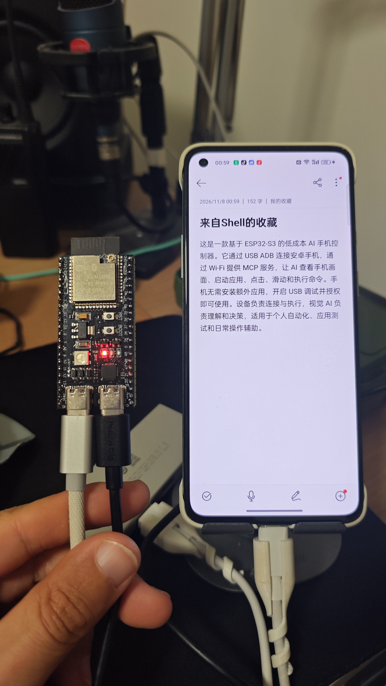
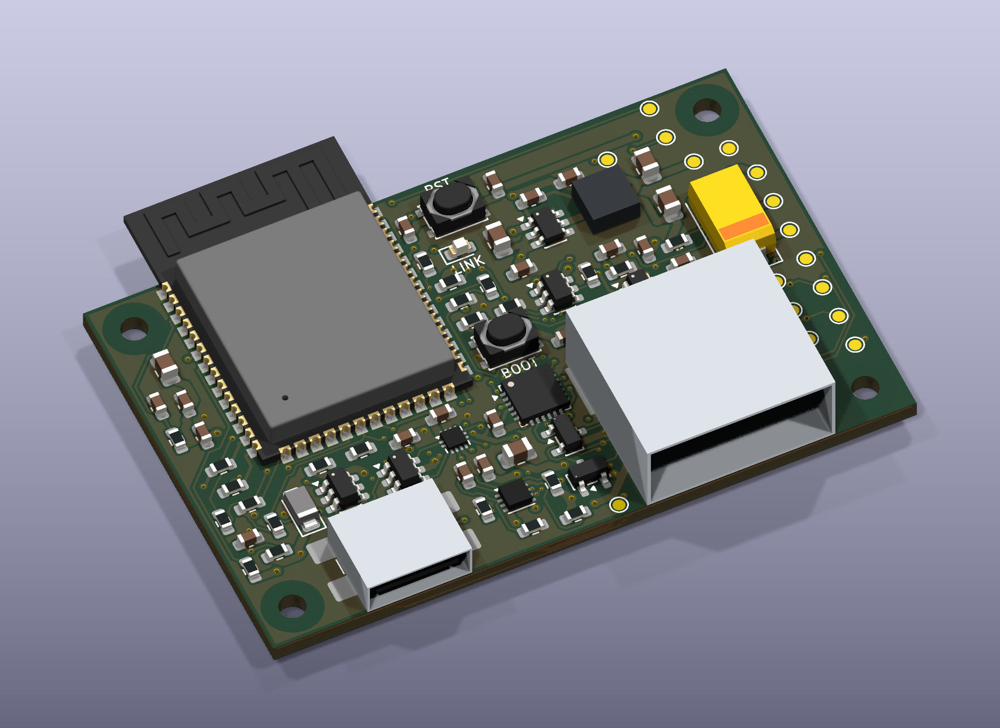
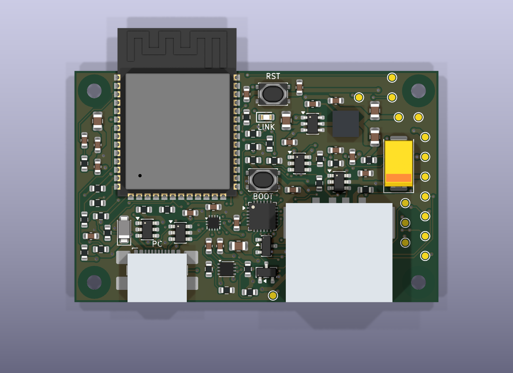

# ESP32-S3 Phone MCP

[English](README.en.md) · [硬件工程](pcb-integrated/README.md) · [MIT License](LICENSE)

**让视觉 AI 通过 Wi-Fi 查看并操作安卓手机。** ESP32-S3 通过 USB ADB 连接手机，在设备上提供带鉴权的 MCP 服务；电脑或云端的多模态 AI 负责理解截图、决定操作，S3 负责执行。

手机无需安装额外应用，需要开启 USB 调试并授权设备。正常操作不依赖电脑上的 ADB 服务，也不依赖单独的 OCR 服务。

## 实拍：已验证的开发板原型



上图是已实测的 **YD-ESP32-23 / ESP32-S3 N16R8 开发板原型**，并非下方集成 PCB 的实物。手机便签中的产品介绍由原型操作输入。照片已移除 EXIF 等元数据。

## 集成 PCB 效果图





- ESP32-S3-WROOM-1-N16R8，独立 CP2102N USB 烧录串口。
- 一个 Type-C 母座接电脑/供电，一个 USB-A 母座接手机，所有焊接引脚为 SMT。
- 55×35mm、四层 PCB，四角 Ø2.2mm M2 固定孔，孔中心距49×29mm。
- 含模组天线伸出部分，组件平面包络约55×41.5mm；外壳还需预留装配和射频净空。
- 输入保护、Type-C 供电能力检测、3.3V 降压与手机端限流保护。

**集成板尚未打样或实板验证。** 当前原理图 ERC、PCB DRC 和一致性检查通过，未连接项为0；这不代表已完成 USB 阻抗、供电浪涌、温升和射频验证。部分3D元件使用简化外形，不能作为精密外壳公差依据。现有固件已在开发板验证，集成板仍需 CC/VBUS 板级适配。未发布制造放行 Gerber。

[KiCad 工程](pcb-integrated/phone-mcp-s3.kicad_pro) · [PCB](pcb-integrated/phone-mcp-s3.kicad_pcb) · [原理图 PDF](pcb-integrated/review/phone-mcp-s3-schematic.pdf) · [BOM](pcb-integrated/BOM.csv) · [检查报告](pcb-integrated/review/STATUS.md)

## 工作原理


截图通过 Wi-Fi 返回给 AI，不经过低速串口。AI 根据截图确定控件位置，调用点击、滑动或应用命令，再截图确认结果。ADB 授权身份在 S3 上使用，每台设备应生成自己的密钥。

## 支持的操作

| 能力 | MCP 工具示例 |
|---|---|
| 查看屏幕与状态 | `phone_screenshot`、`phone_status`、`phone_device_info` |
| 点击、滑动、长按、按键 | `phone_tap`、`phone_swipe`、`phone_long_press`、`phone_keyevent` |
| 应用管理 | `phone_list_apps`、`phone_launch_app`、`phone_stop_app`、`phone_foreground_app` |
| 命令和界面信息 | `phone_adb_shell`、`phone_ui_hierarchy`、`phone_app_info` |
| 唤醒、输入 | `phone_wake_screen`、`phone_input_password`、`phone_input_text` |
| 打开链接 | `phone_open_url` |

当前 MCP 0.4.0 共19个工具。数字 PIN 输入用于输入已知的正确密码，不绕过锁屏；普通文本输入目前仅支持可打印 ASCII。完整参数、返回结构和限制见 [技术说明](README.en.md)。

## 开始使用开发板原型

1. 准备 ESP32-S3 N16R8 开发板、数据线、可用的 USB Host 供电路径，以及已开启 USB 调试的安卓手机。
2. 安装并启用 ESP-IDF 6.1 环境。安卓 platform-tools 仅在本地生成独立 ADB 密钥时需要。
3. 克隆项目并生成本地配置：

```sh
git clone https://github.com/KamiOrz/esp32-s3-phone-mcp.git
cd esp32-s3-phone-mcp
python3 configure_local.py --url http://BOARD_IP/mcp
```

配置脚本交互式读取 Wi-Fi 信息，生成独立 ADB 密钥和 MCP 令牌；配置与密钥文件由 Git 忽略，不会写入公开仓库。

4. 编译烧录（替换串口名）：

```sh
bash hub-probe/build.sh -p /dev/cu.usbserial-PORT -b 460800 build flash
```

5. 在手机上授权设备的 USB 调试请求，然后使用 MCP 客户端连接 `http://BOARD_IP/mcp`，请求头携带 `Authorization: Bearer <本机令牌>`。

命令行测试：

```sh
python3 -m venv .venv
.venv/bin/pip install -r client-requirements.lock.txt
.venv/bin/python phone_cli.py --list
.venv/bin/python phone_cli.py phone_screenshot
.venv/bin/python phone_cli.py phone_launch_app --args '{"package":"com.coloros.calculator"}'
```

开发板的 USB-C 接口不一定支持向手机供电。原型使用板级 USB-OTG 供电改动和 USB Hub，接线应先核对具体开发板的 CC/VBUS 电路；不要把两个电源直接并联。详见[原型接线说明](README.en.md#current-hardware--wiring)。

## 适合什么场景

手机需要离开电脑、固定摆放或通过网络被 AI 调用时，S3 可以作为常驻控制节点。手机就在电脑旁边时，电脑直接连接 ADB 通常更快、功能也更完整。本项目不在 S3 上运行视觉大模型，不提供实时视频流，也不是完整桌面 ADB 的替代品。

当前服务使用局域网 HTTP 和令牌鉴权；不要将手机控制端口直接暴露到公网。手机截图、运行日志、PIN、Wi-Fi 密码和 ADB 私钥都应留在本地。见 [本地数据说明](LOCAL_DATA.md)。

## 目录与许可

- `hub-probe/`：ESP-IDF 固件，USB Host、ADB 与 MCP HTTP 服务。
- `phone_cli.py`、`wifi_client.py`：电脑端调用与截图测试客户端。
- `pcb-integrated/`：KiCad 原理图、PCB、BOM、渲染图和检查报告。
- `docs/images/`：项目实拍图。

原创代码、硬件设计和项目文档/图片按 [MIT](LICENSE) 许可发布，允许按许可证使用、修改与分发。第三方组件保留各自许可证，见 [第三方说明](THIRD_PARTY_NOTICES.md)。
